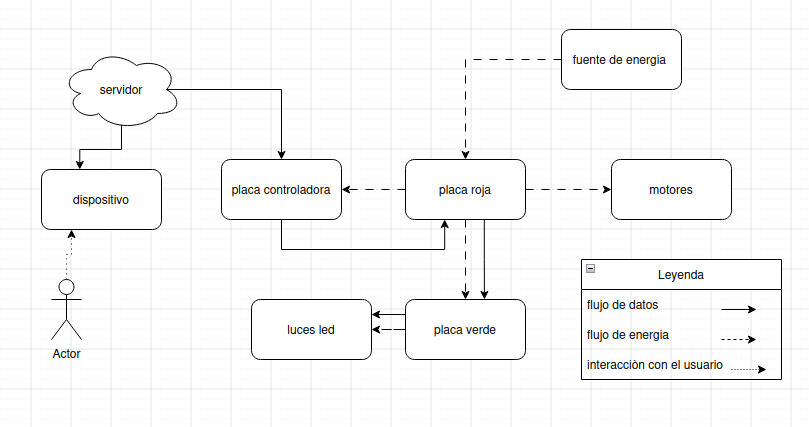

https://github.com/escuela918/proyecto_final.git

en este repositorio hay varias carpetas pero el que se comunica con el motor es el Pedido-de-postal

este proyecto se trata sobre una maquina expendedora que tira postales inspirada en borges en la cual elegimos 6 textos distintos, seleccionamos una frace y de ahi se creo 4 secciones que son la conclusiòn, una asociacion con el internet, una reflexion y una conclusiòn y tienen un QR que te redirige a la pagina web al apartado del libro que escaneaste osea al libro que pertenece la frace 

el deploy:
npm install 
npm run dev 

en otra terminal 
node server.js

conectar el proyecto a corriente 

manual de usuario 
una ves que este abierto la pagina web solo tenes que apretar el boton y de ahi deberia de girar automaticamente el motor una vuelta y deberia de caer la postal 